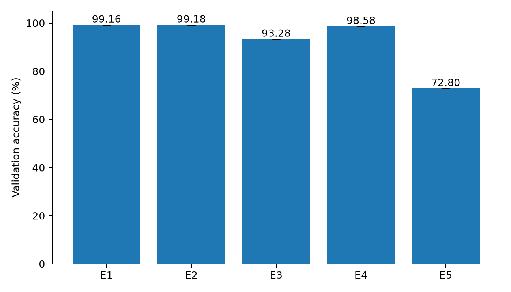
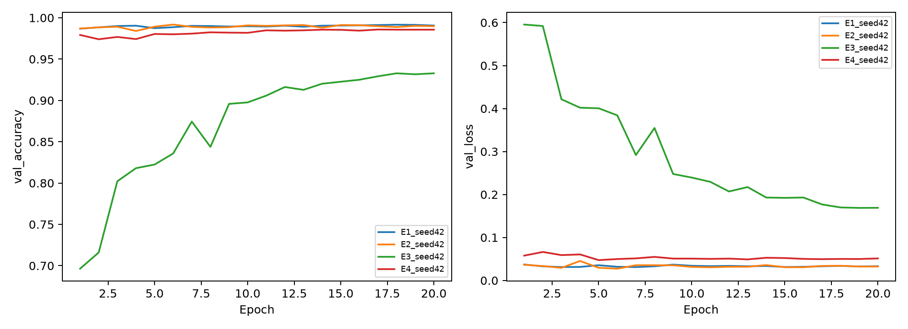

# 包①：数据处理与五组实验实测报告

本报告由已完成的运行记录生成；未完成配置不会填入结果。准确率均为验证集准确率，未使用测试集调参。

## 数据与协议

数据来自课程提供的 datasets.zip。数据审计见 data_audit.json，逐图清单见 data_manifest.csv。固定教师提供的 train/val 划分；标签为 cat=0、dog=1。准确率按样本数计算。

原始训练集20000张、验证集5000张、测试集500张。训练/验证间发现1组完全相同图片；保留验证图并排除对应训练图，同时去除训练集内部多余的完全重复副本。共排除6张训练图，实际训练19994张（每类9997），验证仍为5000张（每类2500）。原文件不修改，所有实验共享excluded_train.json排除清单。这一清理方案须与包②统一后才能直接比较其结果。

E1–E4：ResNet18，2输出，全参数训练，交叉熵；SGD momentum=0.9、weight decay=1e-4、初始学习率0.001、余弦调度。E1/E2/E4使用ImageNet V1预训练，E3从零训练。E1/E3/E4训练增强为水平翻转和±10°旋转，E2关闭增强。短边resize至256/224倍输入尺寸后中心裁剪；输入E1–E3为224、E4为128。采用ImageNet归一化。验证阶段只作确定性处理。按每次运行最高验证准确率选模型，同分取较早轮次。实际轮数、批量、精度和随机种子以各config.json为准。

E5：128×128灰度图，9方向HOG，16×16像素单元、2×2单元块，1764维；仅训练集拟合StandardScaler，线性SVM C=1。未对C做搜索。E5不使用神经预训练。

## 实测结果

| 配置 | 种子 | 验证准确率 | 猫召回率 | 狗召回率 | 最佳轮次 | 总流程秒数 |
|---|---:|---:|---:|---:|---:|---:|
| E1 | 42 | 99.16% | 98.72% | 99.60% | 18 | 1731.0 |
| E2 | 42 | 99.18% | 99.32% | 99.04% | 6 | 1119.8 |
| E3 | 42 | 93.28% | 93.88% | 92.68% | 18 | 1070.7 |
| E4 | 42 | 98.58% | 98.36% | 98.80% | 17 | 748.0 |
| E5 | 42 | 72.80% | 72.36% | 73.24% | None | 291.5 |

## 因素比较

- 数据增强：E1−E2，配对平均差值 -0.02 个百分点（1个配对种子）。
- 预训练：E1−E3，配对平均差值 +5.88 个百分点（1个配对种子）。
- 输入分辨率：E1−E4，配对平均差值 +0.58 个百分点（1个配对种子）。

在本次三个受控因素中，绝对差值最大的是**预训练**（+5.88个百分点）。这一排序仅针对本次模型、数据、种子和训练预算，不代表普遍结论。

差值为正表示本次E1设置更好，为负表示对照设置更好；影响大小应比较绝对值。E5改变特征、分类器与处理方式，属于整条流程对照，不纳入单因素效应排名。

## 解释边界与复现

- 相同训练预算不保证从零训练充分收敛；应结合学习曲线解读预训练差值。未进行独立学习率搜索，不能宣称预训练与从零训练各自最优。
- 若只有一个种子，结果为单次探索性对比，不能声称统计显著或将排名推广到所有数据集。
- 验证集同时用于选模与比较，存在选择偏差；不将其准确率称为测试准确率。
- 哈希审计只检测文件字节完全相同的重复，不能排除重编码重复、语义近重复或预训练数据重叠。
- elapsed_seconds包括建模/特征提取、训练、验证和保存，不是纯训练时间；共享GPU负载也会影响耗时。
- 复现代码、权重版本与参数见runs中的配置；原始日志、权重和预测位于被Git忽略的results/formal目录。

