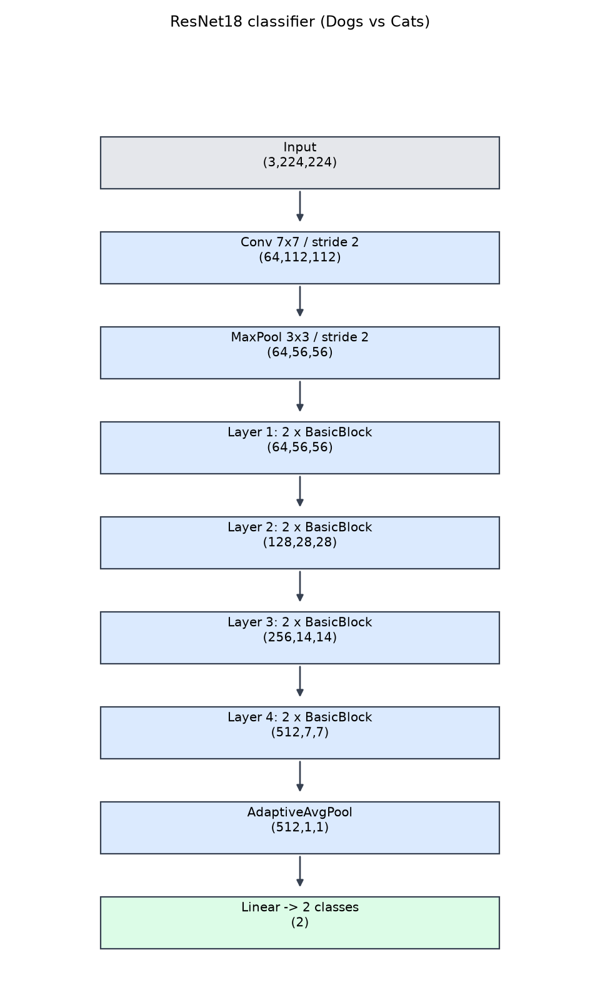
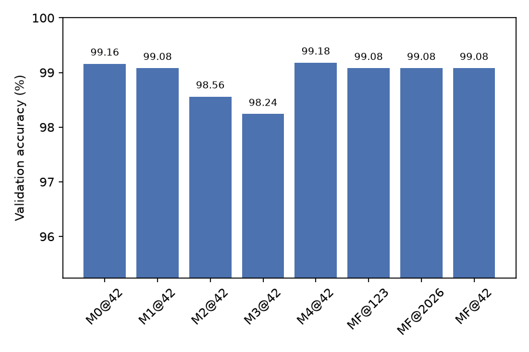
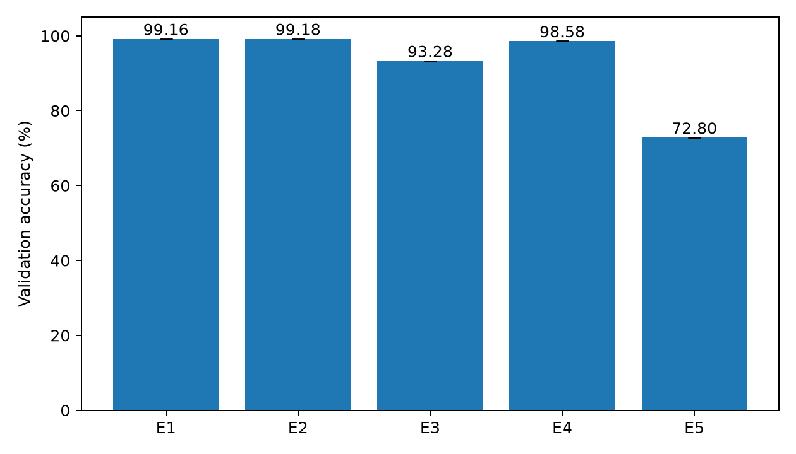
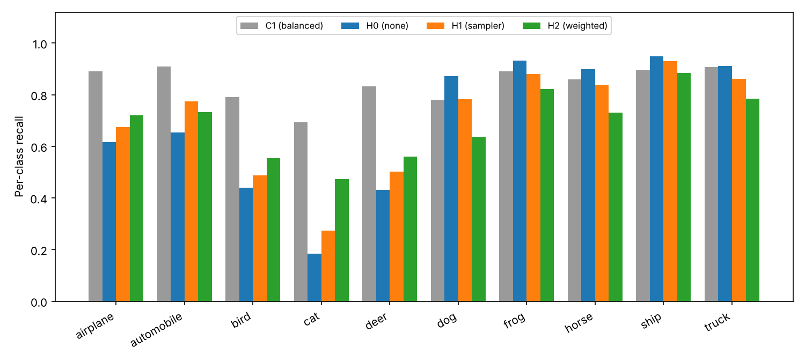
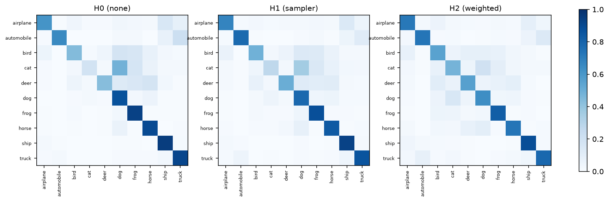

# Group members and contributions

| Member | Contribution |
|---|---|
| LIU JIALE | Data audit and duplicate removal; comparative experiments E1–E5; literature survey |
| ZHANG XUHUA | Main model; hyperparameter study M0–M4 and multi-seed runs MF; submission generation |
| ZHU ZHENGSHUAI | CIFAR-10 experiments C1 and H0–H2; error analysis; result aggregation |

All members reviewed the final report. The code, run records and saved artefacts are available at <https://github.com/chiyi5/cats-vs-dogs>.

# Abstract

We build a cat/dog classifier from the course dataset and extend the study in three directions: a controlled comparison of training choices, an error analysis, and an extension to CIFAR-10 including a class-imbalance experiment. After excluding six redundant training images, an ImageNet-pretrained ResNet18 fine-tuned on 19,994 images reached **99.08% ± 0.00** validation accuracy over three seeds, and the selected model generated the required 500-row submission. A comparison of five pipelines showed that pretrained initialization mattered most (+5.88 percentage points over training from scratch), while mild augmentation and a longer schedule changed accuracy by less than one point. On CIFAR-10, ResNet18 trained from scratch reached 84.47% test accuracy with the ImageNet stem and **92.71%** after adapting the stem to 32 × 32 inputs; under artificial class imbalance the test accuracy fell to 68.87%, and class weighting or minority resampling improved macro-F1 by about 2 points while trading majority-class recall for minority-class recall. All reported numbers come from saved run records; the test set of the dog/cat task is unlabelled, so no test accuracy can be claimed for it.

# 1. Literature survey

## 1.1 Problem definition and challenges

Image classification maps an image $x$ to a label $y$ from a predefined label space. For Dogs vs. Cats the task is supervised binary classification with $\mathcal{Y}=\{\text{cat},\text{dog}\}$; the submission uses 0 for cat and 1 for dog [1]. The training and validation sets carry labels, whereas the 500 test images require predictions.

The task has a short but instructive history. Asirra used cat and dog photographs as a CAPTCHA in 2007, on the assumption that machines could not tell them apart [2]. A year later, an SVM on colour and texture features reached 82.7% accuracy on single Asirra images [3]; for comparison, our HOG + SVM baseline reached 72.80% (Section 7). The Oxford-IIIT Pet dataset then framed cats and dogs as a fine-grained, breed-level problem [4], and the 2013 Kaggle competition, from which the course dataset derives [1], was dominated by deep convolutional features. Today the binary task is largely solved by transfer learning, so the remaining questions concern robustness rather than raw accuracy.

The main difficulties are intra-class variation among breeds, visual similarity between some cats and small dogs, pose and scale changes, occlusion by objects or fences, varying image quality, background shortcuts, limited labelled data and possible distribution shift. Networks are known to exploit such shortcuts — for example, indoor backgrounds or other spurious cues correlated with a class — rather than the intended object [5], and modern networks are often over-confident when they are wrong [6]. High validation accuracy therefore does not by itself establish robustness to unknown classes or unseen domains.

## 1.2 Learning settings

**Supervised versus unsupervised or self-supervised.** Supervised learning optimises a loss on labelled pairs $(x_i,y_i)$, here cross-entropy. Self-supervised methods construct a training signal from the data itself and were reviewed as alternatives: SimCLR contrasts two augmented views [7], MoCo maintains a large queue of negative examples with a momentum encoder [8], MAE reconstructs masked patches [9], and DINOv2 learns general-purpose features without labels [10]. These methods still require a supervised stage for the downstream classifier, and large-scale pretraining carries external data and compute costs. Because labelled cat/dog images are available, supervised fine-tuning is the direct route here.

**Closed-set versus open-set.** This project requires every test image to be cat or dog, so it is closed-set binary classification. Open-set recognition additionally requires rejecting inputs from unknown classes [11]. A useful recent finding is that open-set performance correlates strongly with closed-set accuracy, so a well-trained closed-set classifier with a maximum-logit score is a strong open-set baseline [12]. Still, a two-class softmax cannot guarantee rejection behaviour without a separate evaluation with unknown examples, which we do not perform.

**With versus without domain shift.** Shift occurs when source and target differ in lighting, camera, background or breed. Domain adaptation may use unlabelled target-domain data during training, for example by learning features that a domain classifier cannot separate [13]. Domain generalisation targets unseen domains without their data, using domain alignment, meta-learning, data augmentation or ensembles [14]. The project defines no separate target domain, so validation accuracy must not be presented as out-of-domain generalisation.

## 1.3 Recent developments

We surveyed work along six threads that bear directly on the project, starting from the brief's references [15, 16], survey papers [11, 14] and the reference lists of highly cited papers. The paragraphs below draw out the trends, and Table 1 at the end of this subsection lists the papers by thread.

**From deeper CNNs to Transformers and back.** After AlexNet [17] and VGG [16], residual connections made very deep networks trainable [15], and later work scaled depth, width and resolution together [18]. ViT showed that a plain Transformer on image patches can match CNNs, but only with very large pretraining datasets [19]; DeiT reduced this data requirement through stronger augmentation and distillation [20], and Swin restored a convolution-like hierarchy for dense tasks [21]. ConvNeXt then showed that a ResNet modernised with Transformer-era design choices is as accurate as Swin [22], so the architecture family matters less than the training recipe.

**Transfer learning is the default for small datasets.** Features learned on ImageNet [23] transfer to new tasks, with lower layers more general than higher ones [24]. Across 12 datasets, fine-tuned transfer accuracy correlates strongly with ImageNet accuracy, although pretraining helps little on some small fine-grained datasets [25]. Larger pretraining sets amplify the benefit [26], and image–text pretraining on hundreds of millions of web pairs enables zero-shot classification [27]. For a 20,000-image binary task, these results predict that a pretrained backbone will dominate training from scratch, which our E1–E3 comparison confirms.

**Self-supervision removes the need for labels during pretraining.** Contrastive methods [7, 8] and masked-image modelling [9] now produce representations that rival supervised pretraining, and DINOv2 provides strong frozen features [10]. They matter most when labels are scarce, which is not the case here.

**Recipes and imbalance handling.** Careful schedules and label smoothing yield gains comparable to architecture changes [28], and mixing-based augmentations such as mixup and CutMix improve accuracy and robustness [29, 30]. For imbalanced data, the main families re-weight the loss by class frequency [31] or difficulty [32], enlarge margins for rare classes [33], or decouple representation learning from classifier re-balancing [34]; we draw on the first two families in Section 9.

| Thread | Representative work | Key idea |
|---|---|---|
| CNN architectures | AlexNet [17], VGG [16], ResNet [15], DenseNet [35], EfficientNet [18], ConvNeXt [22] | Depth and residual connections; balanced scaling; modernised convolution design |
| Vision Transformers | ViT [19], DeiT [20], Swin [21] | Self-attention over image patches; data-efficient training; hierarchical windows |
| Transfer and large-scale pretraining | ImageNet [23], Yosinski et al. [24], Kornblith et al. [25], BiT [26], CLIP [27] | Pretrained features transfer; better ImageNet models fine-tune better; image–text pretraining |
| Self-supervised learning | SimCLR [7], MoCo [8], MAE [9], DINOv2 [10] | Learning representations without labels by contrast or reconstruction |
| Training recipes and augmentation | Bag of tricks [28], mixup [29], CutMix [30], RandAugment [36] | Schedule, label smoothing and mixing-based augmentation as accuracy levers |
| Class imbalance | Focal loss [32], class-balanced loss [31], LDAM [33], decoupled training [34] | Re-weighting by frequency or difficulty; margins for rare classes; separate classifier re-balancing |

: Table 1: Papers surveyed, grouped by research thread.

## 1.4 In-depth reading: Kaiming He and collaborators

One group whose work runs through nearly every thread above is that of Kaiming He and collaborators at Microsoft Research and Meta AI (FAIR); He is now at MIT. We read four of their papers in depth because they span the architecture, self-supervision and design questions this project faces.

**ResNet [15].** Plain deep networks become harder to optimise as depth grows: training error rises, which is a degradation problem rather than overfitting. ResNet reformulates each block to learn a residual $F(x)$ added to an identity shortcut, $y = F(x) + x$, so a block can default to the identity. With this change, a 152-layer network won the ILSVRC 2015 classification task. Two details matter for us. First, the ImageNet model begins with a $7 \times 7$ stride-2 convolution and max-pooling, which suits $224 \times 224$ inputs. Second, the paper's own CIFAR-10 experiments use a different stem — a single $3 \times 3$ convolution without down-sampling — because $32 \times 32$ images cannot afford early down-sampling. This is directly relevant to our CIFAR-10 result in Section 8.

**MoCo [8].** Contrastive learning needs many negative examples, but large batches are expensive. MoCo keeps a queue of encoded keys from previous batches as a large dictionary of negatives, and updates the key encoder as a slowly moving average of the query encoder so that keys remain consistent. The resulting unsupervised ResNet-50 representations transferred competitively to detection and segmentation, showing that labels are not essential for pretraining.

**MAE [9].** MAE masks a large random subset of image patches (75%) and trains a Vision Transformer to reconstruct the missing pixels. Its encoder processes only the visible patches, and a lightweight decoder reconstructs the image, which cuts pretraining cost. The high masking ratio makes the task hard enough to require semantic understanding. Fine-tuned MAE models reached state-of-the-art accuracy among methods trained only on ImageNet-1K, showing that self-supervised pretraining scales well with model size.

**ConvNeXt [22].** Starting from a ResNet-50, ConvNeXt applies Transformer-era changes one at a time — a patchify stem, larger depthwise kernels, an inverted bottleneck, LayerNorm and GELU, fewer activations — and measures each step. The final pure-convolution model matches or exceeds Swin Transformers of similar size. The step-by-step method is itself a lesson: many of the claimed advantages of Transformers come from training and design choices that also benefit CNNs. We adopted the same one-factor-at-a-time approach in Sections 4 and 7.

**Synthesis.** Read together, the four papers argue that (i) a residual CNN remains a strong, efficient backbone; (ii) pretraining, supervised or self-supervised, is the main source of accuracy on small datasets; and (iii) design details such as the stem and the training recipe must be matched to the input resolution and data regime. All three points shape our baseline.

## 1.5 Baseline choice and required improvements

We adopt an ImageNet-pretrained ResNet18 with a newly initialised two-output linear head as the baseline. It is small enough to fine-tune several times on available hardware, and the survey above indicates that pretrained convolutional features are the most reliable route on a dataset of this size [24, 25]. Larger backbones such as ConvNeXt [22] or ViT [19] could add accuracy, but the margin available above 99% is small and each run would cost several times more. Our completed comparison supports the choice under the actual budget: pretrained fine-tuning reached 99.16% against 93.28% from random initialization.

Implementing the baseline for this project requires the following adaptations, each tested or justified later in the report:

- **Head and normalisation.** Replace the 1,000-way ImageNet classifier with a two-output layer, and normalise inputs with the ImageNet statistics used during pretraining (Section 3).
- **Full fine-tuning at a low learning rate.** Update all layers so that features adapt to the target classes; Section 4 compares this with freezing the backbone (M3, 0.92 points worse) and with higher and lower learning rates.
- **Mild augmentation.** Flips and small rotations, as recommended for natural images; Section 7 tests whether they help (E2).
- **CIFAR-10 adaptation.** For $32 \times 32$ inputs the ImageNet stem discards too much spatial detail; the CIFAR design of [15] replaces it, which we test as C2 (Section 8).
- **Class imbalance.** Re-sampling and class-weighted loss [31] are applied in Section 9; focal loss [32] and decoupled training [34] are further options.

# 2. Data

## 2.1 Amount and split

The supplied archive contains 20,000 training images (10,000 per class), 5,000 validation images (2,500 per class) and 500 unlabelled test images. All 25,500 images decoded as RGB. We kept the provided split instead of repartitioning, and fixed the label mapping cat = 0, dog = 1.

SHA-256 hashes of all files revealed five groups of exact duplicates. One group contained a training image and a validation image; the other four were entirely inside training. We retained every validation image, dropped the training-side copy of the cross-split duplicate, and removed the remaining redundant training copies. Six training paths were excluded in total, leaving **19,994 training images (9,997 per class)** and **5,000 validation images**. Every experiment used the same lists, enforced through a shared exclusion manifest. Byte hashes cannot detect re-encoded or perceptually similar duplicates, and overlap with the ImageNet pretraining data was not audited.

## 2.2 Pre-processing and augmentation

For an output size $s$, the shorter image side is resized to $\operatorname{round}(256s/224)$ with aspect ratio preserved, then centre-cropped to $s \times s$; $s=224$ for the main experiments and $s=128$ for the resolution control. Tensors are normalised with the ImageNet mean $(0.485,0.456,0.406)$ and standard deviation $(0.229,0.224,0.225)$, matching the pretrained weights. Training adds a random horizontal flip ($p=0.5$) and a rotation sampled uniformly from $[-10^\circ,10^\circ]$; validation uses resize and crop only. Downscaling is permitted by the brief and reduces computation without changing image content.

The 500 test images are transformed deterministically in the same way as validation images and were never used for training or model selection.

# 3. Model and training strategy

## 3.1 Architecture

The classifier is torchvision ResNet18 (`ResNet18_IMAGENET1K_V1`) with its original 1,000-way fully connected layer replaced by a linear layer with two outputs. An input batch of size $B$ occupies $B \times 3 \times 224 \times 224$; the network returns $B \times 2$ logits. The total parameter count is 11,177,538. Figure 1 shows the block structure and the tensor shape after each stage; a per-layer table with output dimensions and parameter counts is included with the code.

{width=42%}

## 3.2 Loss and optimisation

Cross-entropy is applied directly to the logits, and predictions are their argmax. We use SGD with momentum 0.9 and weight decay $10^{-4}$, initial learning rate $10^{-3}$, cosine annealing to zero, batch size 16 and 20 epochs (30 in the schedule study M4). Automatic mixed precision with gradient scaling reduces memory use and speeds up training. The best checkpoint by validation accuracy is saved; ties go to the earlier epoch.

## 3.3 Reproducibility

Python, NumPy and PyTorch seeds are fixed per run (42 for the main experiments, 42/123/2026 for the final configuration). cuDNN benchmarking is disabled and deterministic cuDNN behaviour is requested. These measures control the dominant sources of randomness but do not guarantee bitwise agreement across software and hardware combinations; Section 5.1 shows a concrete case where the same configuration and seed on two GPU models differed by four validation images. The final configuration is repeated over three seeds and reported as mean ± standard deviation, as required for non-deterministic training.

## 3.4 Code and how to run it

The full code is available at <https://github.com/chiyi5/cats-vs-dogs> and is split into three parts: data audit and comparative experiments (`section1/`), the main model (`section2/`), and CIFAR-10 with the imbalance study (`section3/`). Every run records its exact configuration, software versions and GPU in its `config.json`.

```bash
# Comparative experiments E1–E5
python section1/run_all.py

# Dogs vs. Cats: prepare, train the queue, predict, summarise, draw the architecture
python section2/prepare_data.py
python section2/run_all.py --data data/datasets --amp --workers 4
python section2/predict.py --run section2/results/MF_seed42 --data data/datasets \
    --output section2/artifacts/submission.csv
python section2/summarize_results.py
python section2/architecture.py

# CIFAR-10 and imbalance
python section3/run_all.py --data data/cifar10 --amp --workers 4 \
    --queue C1:42 C2:42 H0:42 H1:42 H2:42
python section3/summarize_results.py
python section3/error_analysis.py \
    --predictions section2/results/MF_seed42/val_predictions.csv \
    --data data/datasets --output section3/artifacts
```

`run_all.py` reads each experiment configuration from the command line, skips runs that already have a `metrics.json`, and stops at the first failure. The runs were made on three machines: E1–E5 on an RTX 3060 Laptop GPU with PyTorch 2.5.1+cu121 and two data-loading workers; M0 on an RTX A6000; M1–M4, MF, C1 and H0–H2 on an L40S; and C2 on the RTX 3060 Laptop GPU. The A6000 and L40S runs used PyTorch 2.11.0+cu128, torchvision 0.26.0+cu128 and NumPy 2.5.4 with four data-loading workers; C2 used the same PyTorch version with two workers.

# 4. Hyperparameter study (c)

We varied one factor at a time from the reference configuration M0 (= E1 from Section 7) with seed 42. All other settings — architecture, augmentation, optimiser, batch size, checkpoint rule — were held fixed.

| ID | Change | Epochs | Validation accuracy |
|---|---|---:|---:|
| M0 | reference, lr $10^{-3}$ | 20 | 99.16% |
| M1 | lr $10^{-4}$ | 20 | 99.08% |
| M2 | lr $10^{-2}$ | 20 | 98.56% |
| M3 | freeze the backbone, train the head only | 20 | 98.24% |
| M4 | train for 30 epochs | 30 | 99.18% |

Learning rate $10^{-3}$ was chosen because it sits between the two tested alternatives: $10^{-4}$ lost 0.08 points, consistent with slower convergence within the fixed epoch budget, while $10^{-2}$ lost 0.60 points, consistent with unstable optimisation of a pretrained network. Freezing the backbone was the most damaging change (0.92 points), which is why the final pipeline fine-tunes all layers. M3's validation accuracy had levelled off over its last five epochs (98.16–98.24%), so the gap does not stem from stopping too early. Extending training from 20 to 30 epochs changed accuracy by +0.02 points, so the shorter schedule is retained for the multi-seed runs. With 5,000 validation images one additional correct prediction changes accuracy by 0.02 points, so differences of a few images should not be over-interpreted; each of M0–M4 is a single run.

# 5. Results and submission (d)

## 5.1 Validation accuracy

The final configuration MF equals M0 and was repeated over three seeds. It is the configuration that generates the submission.

| Run | Validation accuracy | Cat recall | Dog recall | Best epoch |
|---|---:|---:|---:|---:|
| MF seed 42 | 99.08% | 98.96% | 99.20% | 19 |
| MF seed 123 | 99.08% | 99.04% | 99.12% | 2 |
| MF seed 2026 | 99.08% | 99.12% | 99.04% | 7 |
| **Mean ± std** | **99.08% ± 0.00** | 99.04% ± 0.08 | 99.12% ± 0.08 | — |

All three seeds produced the same validation accuracy (46 errors out of 5,000) although their best epochs differ. At this accuracy level the 5,000-image validation set no longer resolves seed-to-seed differences; a larger validation set or repeated evaluation would be needed to separate them.

MF seed 42 uses the same configuration, code and seed as M0, yet reached 99.08% instead of 99.16% with a different best epoch. The saved configurations differ only in the GPU: M0 ran on an RTX A6000 and MF on an L40S. The most likely cause is that CUDA kernels under mixed precision give slightly different floating-point results on different GPU models; over 20 epochs these differences change the training trajectory enough to move four validation images. This variation is as large as the M1 and E2 differences, which we already treat as not meaningful. It is far smaller than the effects of pretraining, freezing the backbone or a learning rate of $10^{-2}$.

{width=65%}

## 5.2 Test predictions and submission

Since the test split has no labels, the model cannot be scored locally. We selected the run with the highest validation accuracy; as the three MF seeds tie at 99.08%, the rule "highest validation accuracy, ties broken by the smallest seed" selects `MF_seed42`. Its predictions form `submission.csv`: exactly 500 rows, ids 1–500, two columns `id,label`, with label 1 = dog and 0 = cat. The submitted distribution is 261 dogs and 239 cats.

No test accuracy for Dogs vs. Cats can therefore be reported; validation accuracy is the only locally measurable estimate of generalisation.

## 5.3 Relation to the comparative experiments (Section 7)

The reference configuration M0 reached the same validation accuracy as experiment E1 (99.16%, 42 errors each), although the two were run with different code bases, PyTorch versions, GPUs and numbers of data-loading workers. Given the four-image variation observed between M0 and MF seed 42, the identical figure is partly coincidental. It is consistent with the data lists, split, preprocessing and selection rules agreeing between the two parts of the project, but it does not show bitwise reproducibility. The final three-seed mean, 99.08%, is within 0.08 points (four images) of E1, so the choice of the final configuration does not depend on a lucky run.

# 6. Error analysis (e)

The test images carry no labels, so the model cannot be scored on them automatically. Instead we inspected all 500 test images by eye and compared each with its predicted label in `submission.csv`. Of the 498 images that show a cat or a dog, we found one clear misclassification (`test/216.jpg`); the remaining two images (`test/328.jpg` and `test/464.jpg`) contain no animal at all. Visual inspection was done on reduced-size images and is not a substitute for ground-truth labels, but it is consistent with the 99.08% validation accuracy. Figure 3 shows the cases discussed below.

{width=72%}

## 6.1 Incorrect and invalid cases

1. **`test/216.jpg` — a cat predicted as a dog.** The photo shows a black-and-white cat in a shelter cage, with a second, darker cat behind it. Two lines of yellow text are burned into the image, listing the shelter IDs, sex and coat of both animals, and the vertical bars of the cage cross the whole frame. The cat's face, the most discriminative region, occupies one corner, while text and bars cover most of the image. Neither occurs in typical training photos, so the classifier receives features it has not learned to ignore. The case resembles the validation error `cat/cat.9897.jpg`, a cat behind a chain-link fence, which suggests that heavy foreground occlusion is a systematic weakness rather than a one-off.

2. **`test/328.jpg` and `test/464.jpg` — no animal, predicted as dog.** Both show the same shelter placeholder: a brown dog silhouette with the words "No Photo Available". Neither label is correct, because there is no cat or dog in the image. A two-class softmax must still choose one class, and the dog-shaped silhouette makes "dog" the natural choice. This is the closed-set limitation discussed in Section 1.2 [11, 12]: the model has no way to answer "neither". In deployment, such images should be caught by an out-of-distribution check rather than by the classifier.

## 6.2 Correct cases

3. **`test/245.jpg` — a dog behind bars, predicted correctly.** A large brown dog is photographed through a white grid that covers the whole frame, a denser occluder than in `test/216.jpg`. Here, however, the dog's head and fur fill the image, so enough of the animal remains visible between the bars. Comparing the two images suggests that occlusion becomes harmful when the animal is small relative to the occluder, not merely when an occluder is present.

4. **`test/425.jpg` — a 59 × 50-pixel dog, predicted correctly.** The image is upscaled about fourfold to 224 × 224, so fine texture is lost, yet the head shape and fur pattern survive. This agrees with the resolution comparison in Section 7, where 128-pixel inputs cost only 0.58 points: coarse shape is enough for most images.

## 6.3 Supporting evidence from the validation set

Because the test set is unlabelled, error statistics can only come from the 5,000 labelled validation images. `MF_seed42` makes 46 validation errors: 26 cats predicted as dogs and 20 dogs predicted as cats. The four most confident of them show the same occlusion pattern as `test/216.jpg` (`cat/cat.9897.jpg`, a cat behind a chain-link fence) and two further patterns: an unusual pose or orientation (`dog/dog.7332.jpg` is rotated by 90°, and `dog/dog.669.jpg` is seen from above), and a second animal that dominates the frame (`cat/cat.7920.jpg`, a cat lying next to a larger dog). Confidence is only a partial warning signal: the median confidence of a wrong prediction is 0.80, but 9 of the 46 errors exceed 0.99, consistent with the over-confidence of modern networks [6].

## 6.4 Strengths and weaknesses

**Strengths.** The model is robust to low resolution, cluttered backgrounds and partial occlusion as long as the animal fills a reasonable part of the frame: `test/245.jpg` and `test/425.jpg` are classified correctly despite dense bars and very few pixels, and only one of the 498 animal images in the test set appears to be misclassified.

**Weaknesses.** The model fails when the animal is small relative to an occluder or overlaid text (`test/216.jpg`), when another animal dominates the frame, or when the pose is unusual, and some of these failures come with near-certain confidence. It also cannot reject images that contain no animal (`test/328.jpg`).

**Improvements.** Test-time augmentation over flips and small rotations would stabilise predictions against moderate pose changes; large rotations would additionally need wider rotation augmentation during training. Occlusion-style augmentation such as CutMix [30] would expose the model to partially hidden animals during training. An out-of-distribution score such as the maximum logit [12] would let placeholders like `test/328.jpg` be flagged instead of being forced into a class.

# 7. Effect of models and data processing (f)

The first part of the code (`section1/`) runs five controlled pipelines evaluated on the same cleaned data. The contrasts quantify how model and processing choices affect validation accuracy.

| ID | Pipeline | Validation accuracy | Best epoch |
|---|---|---:|---:|
| E1 | ResNet18, ImageNet pretrained, flip + rotation, 224 px | 99.16% | 18 |
| E2 | E1 without random augmentation | 99.18% | 6 |
| E3 | ResNet18 trained from scratch, flip + rotation, 224 px | 93.28% | 18 |
| E4 | E1 at 128 px input | 98.58% | 17 |
| E5 | HOG features [37] + linear SVM [38] | 72.80% | — |

Controlled differences relative to E1:

| Contrast | Factor | Difference |
|---|---|---:|
| E1 − E2 | mild augmentation | −0.02 pp |
| E1 − E3 | pretrained initialization | +5.88 pp |
| E1 − E4 | 224 vs. 128 input resolution | +0.58 pp |
| E1 − E5 | learned CNN vs. HOG + SVM pipeline | +26.36 pp |

**Initialization is the dominant factor.** Removing ImageNet pretraining increased errors from 42 to 336 out of 5,000. The gain is conditional on the common 20-epoch budget and includes the benefit of external data; it is not evidence that a separately tuned scratch model could never catch up.

**Augmentation produced no measurable gain in this comparison.** E2 was one image better than E1. We keep mild augmentation as a reasonable default but make no accuracy claim for it; a single seed, one augmentation policy and two transforms that were not ablated separately do not support a general conclusion.

**Higher resolution helped modestly.** The 224-pixel model was 29 images better than the 128-pixel model, which is plausible given finer detail but not proven by these runs. The 128-pixel model still reached 98.58% and is a sensible option under tighter compute.

**Classical features are far behind.** HOG features with a linear SVM [37, 38] lost 26.36 points, consistent with the value of learned representations here, although the comparison changes colour handling, feature learning and classifier together, so it isolates no single cause.

Combined with the hyperparameter study, the practical recipe for this dataset is: pretrained ResNet18, full fine-tuning, $10^{-3}$ learning rate, 20 epochs, 224-pixel inputs, mild augmentation. Freezing, training from scratch, or a tenfold higher learning rate each cost between 0.6 and 5.9 points.

{width=65%}

# 8. CIFAR-10 (g)

## 8.1 Dataset and problem

CIFAR-10 [39] contains 60,000 colour images of 32 × 32 pixels in 10 classes: airplane, automobile, bird, cat, deer, dog, frog, horse, ship, truck. The official split provides 50,000 training and 10,000 test images; the test set is balanced and has labels, so test accuracy is directly measurable, unlike the dog/cat test split. We use a fixed internal split of the 50,000 training images into 45,000 for training and 5,000 for validation (seed 42); model selection uses only the internal validation set, and the official test set is evaluated once per configuration.

The classes differ in several ways from Dogs vs. Cats: two animal classes are replaced by eight object and animal categories, images are 32 × 32 instead of 224 × 224, and intra-class variation is driven by viewpoint and object type rather than breed. Ten balanced classes also make a single accuracy number harder to interpret than in a binary task.

## 8.2 Changes to the pipeline

| Aspect | Dogs vs. Cats | CIFAR-10 |
|---|---|---|
| Input | 224 × 224 RGB | 32 × 32 RGB |
| Classes | 2 | 10 |
| Initialization | ImageNet pretrained | random (trained from scratch) |
| Augmentation | flip + 10° rotation | RandomCrop(32, 4) + flip |
| Batch size | 16 | 128 |
| Initial learning rate | $10^{-3}$ | 0.1 |
| Weight decay | $10^{-4}$ | $5\times10^{-4}$ |
| Epochs | 20 | 30 |
| Optimiser / schedule | SGD + cosine | SGD + cosine |
| Network stem | 7 × 7 conv, stride 2, + max-pool | C1: unchanged; C2: 3 × 3 conv, stride 1, no max-pool |

Training from scratch is the natural choice at 32 pixels: ImageNet features are tuned to a much larger input and to natural-image textures, and the brief asks for the same algorithm to be adapted rather than for a second transfer-learning study. The smaller images allow a much larger batch; the learning rate of 0.1 and weight decay of $5\times10^{-4}$ follow the standard SGD recipe for training ResNets from scratch on CIFAR-10, rather than being scaled from the fine-tuning setting. C1 keeps the unmodified torchvision ResNet18 with a 10-way output layer; C2 additionally replaces the stem, as explained in Section 8.3.

## 8.3 Results

| Experiment | Data | Test accuracy | Macro-F1 | Internal val accuracy | Train images |
|---|---|---:|---:|---:|---:|
| C1 | full CIFAR-10 training split | **84.47%** | 0.8452 | 85.10% | 45,000 |
| C2 | full CIFAR-10 training split, CIFAR stem | **92.71%** | 0.9270 | 92.74% | 45,000 |
| H0 | imbalanced subset, no correction | 68.87% | 0.6664 | 67.58% | 24,800 |

C1 reaches 84.47% on the 10,000-image test set, slightly below the 85–92% range we had set as our own target, and its training accuracy reached only about 90%, so the model was still underfitting within the 30-epoch budget. We traced the shortfall to the network stem. The ImageNet stem (a 7 × 7 stride-2 convolution followed by max-pooling) reduces a 32 × 32 input to 8 × 8 before the first residual stage and to 1 × 1 at the last, discarding spatial detail that small images cannot spare. Following the CIFAR-10 networks of the original ResNet paper [15], C2 replaces the stem with a 3 × 3 stride-1 convolution and removes the max-pool, so the residual stages operate at 32 × 32 down to 4 × 4. Everything else — data split, augmentation, optimiser, learning rate, 30 epochs, seed — is identical to C1. C2 reaches 92.71% test accuracy and a macro-F1 of 0.9270, an improvement of 8.24 points from a two-line change. The gain has a computational price: removing the early down-sampling enlarges the feature maps of all four residual stages by a factor of 16 in area, raising the cost to roughly 0.56 billion multiply–accumulate operations per image, about 15 times that of C1. C1 trained in about 1.5 minutes on the L40S and C2 in about 10 minutes on the RTX 3060 Laptop GPU; because the GPUs differ, these wall-clock times are not directly comparable, but the FLOP ratio shows that C2 is substantially more expensive. This is the main adaptation our algorithm needs for CIFAR-10: input resolution, not the number of classes, dictates the stem. The imbalance study in Section 9 keeps the C1 architecture so that its results remain comparable with the runs already completed; C1 is therefore its balanced reference. C1's per-class recall varies from 69.3% (cat) to 91.0% (automobile), reflecting the visual difficulty of the animal classes at this resolution (Figure 5). C2 raises every class: its recall ranges from 82.8% (cat) to 96.7% (automobile), and its largest remaining confusion is between cat and dog (78 cats predicted as dogs and 65 dogs as cats), the same pair as our main task. C2 fits its training data almost completely (99.1% training accuracy), so unlike C1 it is not limited by the training budget.

# 9. Class imbalance (h)

## 9.1 How imbalance is created

Five classes (0–4: airplane, automobile, bird, cat, deer) are treated as minority classes and randomly subsampled to 10% of their images using a fixed seed (42). The remaining five classes (5–9) keep all examples. The resulting training set has 24,800 images with class counts 453, 446, 446, 452, 448, 4,527, 4,498, 4,531, 4,482, 4,517. The official test set is **not** subsampled, so any accuracy drop is caused by the training distribution rather than by the evaluation data. The internal 5,000-image validation set is also kept balanced and identical to C1, so checkpoint selection for H0–H2 is not biased towards the majority classes.

## 9.2 Two correction methods

**H1 — weighted random sampling.** Each training image is drawn with probability proportional to the inverse class frequency, so minority images are repeated and majority images are seen less often per epoch. This changes the effective distribution seen by the loss without changing the loss itself. It is simple and model-agnostic, but the minority examples are repeated, which increases overfitting risk on the few available samples.

**H2 — class-weighted cross-entropy.** The loss of each example is multiplied by a weight proportional to the inverse class frequency, normalised so the mean weight is one. This preserves the natural sampling of examples and instead tells the optimiser that errors on rare classes matter more. It costs nothing at the data level and is easy to add to any training loop, but it can over-emphasise tiny classes when their sample counts are extreme.

Both belong to the re-weighting family surveyed in Section 1.3 [31]; margin-based losses [33], focal loss [32] and decoupled classifier re-balancing [34] are alternatives we did not run. Both approaches were trained with the C1 recipe on the same imbalanced subset; only the loss or sampler changes.

## 9.3 Results and per-class effect

| Experiment | Method | Test accuracy | Macro-F1 | Minority-class mean recall | Majority-class mean recall |
|---|---|---:|---:|---:|---:|
| H0 | none | 68.87% | 0.6664 | 46.54% | 91.20% |
| H1 | weighted sampling | 70.03% | 0.6875 | 54.22% | 85.84% |
| H2 | class-weighted CE | 69.00% | 0.6878 | 60.82% | 77.18% |

Relative to H0, H1 raises minority recall by 7.68 points and lowers majority recall by 5.36 points; H2 raises minority recall by 14.28 points and lowers majority by 14.02 points. Both improve macro-F1 by about 2 points, while aggregate accuracy improves by only 1.16 (H1) and 0.13 (H2) points.





## 9.4 Why aggregate accuracy hides the problem

Under H0, the majority classes retain about 91% recall while the minority classes average 46.5%, and the cat class alone drops to 18.5%. A single accuracy number cannot reveal this: a model could reach 69% by being excellent on five classes and nearly ignoring the other five. Macro-F1, which averages per-class performance, drops from 0.845 (balanced C1) to 0.666 under H0 and recovers to about 0.688 under both corrections. When class costs are unequal, per-class recall and macro-F1 must be reported alongside accuracy.

The trade-off is also visible: H2 gains the most minority recall but loses the most majority recall, which explains why its accuracy hardly moves. H1 is the milder intervention and gives a slightly better aggregate result. Neither approach closes the gap to the balanced experiment; the imbalance remains the dominant error source, and stronger remedies (hard-example mining, two-stage training, or generating synthetic minority samples) would be needed to recover more.

# 10. Discussion and limitations

- **Single-seed comparisons.** E1–E5 and M0–M4 were each run once; observed differences of a few images may not replicate. The final configuration is repeated over three seeds, but all three tie on validation accuracy, so the reported standard deviation is not evidence that runs are identical.
- **Validation-based selection.** Checkpoints and the submission model were chosen on the validation set, so validation accuracy is optimistic relative to unseen data. Test accuracy cannot be computed for Dogs vs. Cats because labels are withheld.
- **Duplicate detection.** SHA-256 hashes remove exact duplicates only; re-encoded or perceptually similar images could remain, and overlap with ImageNet pretraining data was not audited.
- **Error analysis scope.** The test-set analysis relies on our visual judgement rather than ground-truth labels, and error statistics come from the validation set; the few cases discussed in detail may not be representative of all errors.
- **Hardware.** The experiments ran on three GPU models and two PyTorch versions. The same configuration and seed differed by four validation images across GPUs (Section 5.1), so differences of that size between runs on different machines carry no information.
- **Pretraining budget.** The advantage of pretraining, and the CIFAR-10 accuracy, are conditional on the chosen epochs, augmentation and learning rates; neither is an upper bound for the architectures. The imbalance study uses the C1 architecture, so its absolute accuracies would likely be higher with the CIFAR stem of C2.
- **CIFAR-10 runs.** C1 and C2 were each run once with seed 42, and on different GPUs. The 8.24-point gain of C2 is far larger than the seed and hardware variation seen elsewhere in this report (a few tenths of a point), so its direction is reliable, but its exact size is not established.
- **Imbalance study.** One seed per method; the direction of the trade-off is clear, but its size is exploratory.

# 11. References

::: {style="font-size: 9pt; line-height: 1.3"}
[1] EE6483, *Mini Project (Option 2): Dogs vs. Cats*, assignment brief, 2026. Dataset and submission template supplied by the teaching team.

[2] J. Elson, J. R. Douceur, J. Howell, and J. Saul, "Asirra: A CAPTCHA that exploits interest-aligned manual image categorization," ACM CCS, 2007.

[3] P. Golle, "Machine learning attacks against the Asirra CAPTCHA," ACM CCS, 2008.

[4] O. M. Parkhi, A. Vedaldi, A. Zisserman, and C. V. Jawahar, "Cats and dogs," CVPR, 2012.

[5] R. Geirhos et al., "Shortcut learning in deep neural networks," *Nature Machine Intelligence*, vol. 2, pp. 665–673, 2020.

[6] C. Guo, G. Pleiss, Y. Sun, and K. Q. Weinberger, "On calibration of modern neural networks," ICML, 2017.

[7] T. Chen, S. Kornblith, M. Norouzi, and G. Hinton, "A Simple Framework for Contrastive Learning of Visual Representations," ICML, 2020.

[8] K. He, H. Fan, Y. Wu, S. Xie, and R. Girshick, "Momentum contrast for unsupervised visual representation learning," CVPR, 2020.

[9] K. He et al., "Masked Autoencoders Are Scalable Vision Learners," CVPR, 2022.

[10] M. Oquab et al., "DINOv2: Learning Robust Visual Features without Supervision," arXiv:2304.07193, 2023.

[11] C. Geng, S.-J. Huang, and S. Chen, "Recent Advances in Open Set Recognition: A Survey," arXiv:1811.08581, 2018.

[12] S. Vaze, K. Han, A. Vedaldi, and A. Zisserman, "Open-set recognition: A good closed-set classifier is all you need," ICLR, 2022.

[13] Y. Ganin et al., "Domain-adversarial training of neural networks," *Journal of Machine Learning Research*, vol. 17, 2016.

[14] K. Zhou, Z. Liu, Y. Qiao, T. Xiang, and C. C. Loy, "Domain generalization: A survey," *IEEE TPAMI*, vol. 45, no. 4, pp. 4396–4415, 2023.

[15] K. He, X. Zhang, S. Ren, and J. Sun, "Deep Residual Learning for Image Recognition," CVPR, 2016.

[16] K. Simonyan and A. Zisserman, "Very deep convolutional networks for large-scale image recognition," ICLR, 2015.

[17] A. Krizhevsky, I. Sutskever, and G. E. Hinton, "ImageNet classification with deep convolutional neural networks," NeurIPS, 2012.

[18] M. Tan and Q. V. Le, "EfficientNet: Rethinking model scaling for convolutional neural networks," ICML, 2019.

[19] A. Dosovitskiy et al., "An image is worth 16x16 words: Transformers for image recognition at scale," ICLR, 2021.

[20] H. Touvron et al., "Training data-efficient image transformers & distillation through attention," ICML, 2021.

[21] Z. Liu et al., "Swin Transformer: Hierarchical vision transformer using shifted windows," ICCV, 2021.

[22] Z. Liu et al., "A ConvNet for the 2020s," CVPR, 2022.

[23] J. Deng, W. Dong, R. Socher, L.-J. Li, K. Li, and L. Fei-Fei, "ImageNet: A large-scale hierarchical image database," CVPR, 2009.

[24] J. Yosinski, J. Clune, Y. Bengio, and H. Lipson, "How transferable are features in deep neural networks?" NeurIPS, 2014.

[25] S. Kornblith, J. Shlens, and Q. V. Le, "Do better ImageNet models transfer better?" CVPR, 2019.

[26] A. Kolesnikov et al., "Big Transfer (BiT): General visual representation learning," ECCV, 2020.

[27] A. Radford et al., "Learning transferable visual models from natural language supervision," ICML, 2021.

[28] T. He et al., "Bag of tricks for image classification with convolutional neural networks," CVPR, 2019.

[29] H. Zhang, M. Cisse, Y. N. Dauphin, and D. Lopez-Paz, "mixup: Beyond empirical risk minimization," ICLR, 2018.

[30] S. Yun et al., "CutMix: Regularization strategy to train strong classifiers with localizable features," ICCV, 2019.

[31] Y. Cui, M. Jia, T.-Y. Lin, Y. Song, and S. Belongie, "Class-balanced loss based on effective number of samples," CVPR, 2019.

[32] T.-Y. Lin, P. Goyal, R. Girshick, K. He, and P. Dollár, "Focal loss for dense object detection," ICCV, 2017.

[33] K. Cao, C. Wei, A. Gaidon, N. Arechiga, and T. Ma, "Learning imbalanced datasets with label-distribution-aware margin loss," NeurIPS, 2019.

[34] B. Kang et al., "Decoupling representation and classifier for long-tailed recognition," ICLR, 2020.

[35] G. Huang, Z. Liu, L. van der Maaten, and K. Q. Weinberger, "Densely connected convolutional networks," CVPR, 2017.

[36] E. D. Cubuk, B. Zoph, J. Shlens, and Q. V. Le, "RandAugment: Practical automated data augmentation with a reduced search space," CVPR Workshops, 2020.

[37] N. Dalal and B. Triggs, "Histograms of Oriented Gradients for Human Detection," CVPR, 2005.

[38] C. Cortes and V. Vapnik, "Support-vector networks," *Machine Learning*, vol. 20, pp. 273–297, 1995.

[39] A. Krizhevsky, "Learning Multiple Layers of Features from Tiny Images," technical report, 2009.
:::
