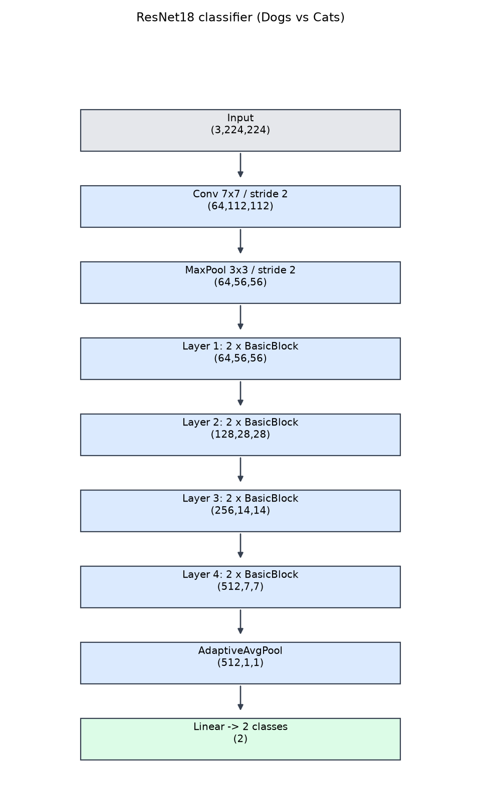

# 包②：Dogs vs Cats 迁移学习实测报告

本报告由已完成的运行记录生成；准确率均为验证集准确率，测试集无标签，未用于调参。

## 数据与协议

数据来自课程 datasets.zip，经包①审计后使用：训练 19994 张（每类 9997）、验证 5000 张（每类 2500）、测试 500 张（无标签）。排除 6 张与验证集完全重复或有内部重复的训练图，清单见 `section1/artifacts/excluded_train.json`。划分沿用教师给定的 train/val，标签为 cat=0、dog=1。

模型为 torchvision ResNet18（`ResNet18_IMAGENET1K_V1` 预训练），输出层改为 2 类。输入 3×224×224，短边 resize 至 256 后中心裁剪；训练增强为水平翻转 + ±10° 旋转，验证只做确定性处理并使用 ImageNet 归一化。损失为交叉熵，SGD momentum=0.9、weight decay=1e-4、余弦退火，batch=16，AMP 混合精度。按最高验证准确率保存 `best.pt`，同分取较早轮次。

实验矩阵（同一种子 42 做单因素对比）：

| 编号 | 变量 |
|---|---|
| M0 | lr=1e-3，20 轮（复现包① E1 配置） |
| M1 | lr=1e-4 |
| M2 | lr=1e-2 |
| M3 | 冻结骨干，只训分类头 |
| M4 | 训练 30 轮 |
| MF | 最终配置 = M0，三个种子 42/123/2026，报告 mean ± std |

## 实测结果

| 配置 | 种子 | 验证准确率 | 猫召回率 | 狗召回率 | 最佳轮次 | 总流程秒数 |
|---|---:|---:|---:|---:|---:|---:|
| M0 | 42 | 99.16% | 99.00% | 99.32% | 15 | 781.2 |
| M1 | 42 | 99.08% | 99.04% | 99.12% | 19 | 500.0 |
| M2 | 42 | 98.56% | 98.40% | 98.72% | 18 | 483.7 |
| M3 | 42 | 98.24% | 98.32% | 98.16% | 20 | 457.6 |
| M4 | 42 | 99.18% | 98.88% | 99.48% | 27 | 712.9 |
| MF | 42 | 99.08% | 98.96% | 99.20% | 19 | 478.6 |
| MF | 123 | 99.08% | 99.04% | 99.12% | 2 | 479.1 |
| MF | 2026 | 99.08% | 99.12% | 99.04% | 7 | 484.8 |

**MF 汇总：99.08% ± 0.00 个百分点（3 个种子）。** 三个种子的最佳轮次差异较大（19/2/7），但验证准确率相同，说明该配置在 5000 张验证集上已接近饱和。

## 因素比较

- 学习率：M0(1e-3) − M1(1e-4) = +0.08pp；M0 − M2(1e-2) = +0.60pp。学习率过大或过小都不如 1e-3。
- 冻结骨干：M0 − M3 = +0.92pp，是本组中影响最大的单因素，说明预训练特征需要微调才能达到最高精度。
- 训练轮数：M4(30 轮) − M0(20 轮) = +0.02pp，在当前预算下延长训练基本无收益。

以上均为单种子、单次运行的探索性对比，不构成统计显著性结论。

## 与包①实验的关系

M0 与 E1 配置完全相同，验证准确率 99.16% vs 99.16%（差值 0.00pp），确认数据、划分、预处理与包①一致，后续结果可直接比较。MF 使用同一配置但引入增强并跨种子重复，均值 99.08%，与 E1/M0 处于同一水平。

## 提交文件

`submission.csv` 由 MF 中最优验证准确率者生成；三种子并列 99.08%，按「最高验证准确率，并列取种子 42」的规则选用 `MF_seed42`。文件共 500 行，id 为 1–500，label∈{0,1}，其中 dog=261、cat=239。

## 架构



逐层输出维度与参数量见 `model_summary.txt`，总参数量 11,177,538。

## 复现

```bash
python section2/prepare_data.py
python section2/run_all.py --data data/datasets --amp --workers 4
python section2/predict.py --run section2/results/MF_seed42 --data data/datasets \
    --output section2/artifacts/submission.csv
python section2/summarize_results.py
python section2/architecture.py
```

实际轮数、批量、精度、GPU 型号与库版本见 `runs/*/config.json`。权重与完整日志保存在被 Git 忽略的 `results/`。

## 解释边界

- 验证集同时用于选模与报告，存在选择偏差，不能当作测试准确率。
- M0–M4 各只有一个种子，差值可能包含训练随机性；MF 三种子结果完全一致，提示验证集分辨率已不足以区分种子差异。
- `elapsed_seconds` 含数据加载、训练、验证与保存，且共享 GPU 负载会影响耗时，不等于纯训练时间。
- 测试集无标签，无法在本地评估真实泛化精度，只能通过提交结果反馈。
