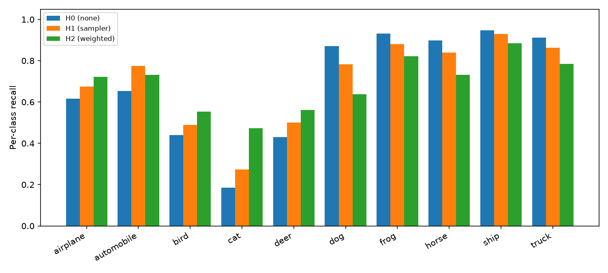
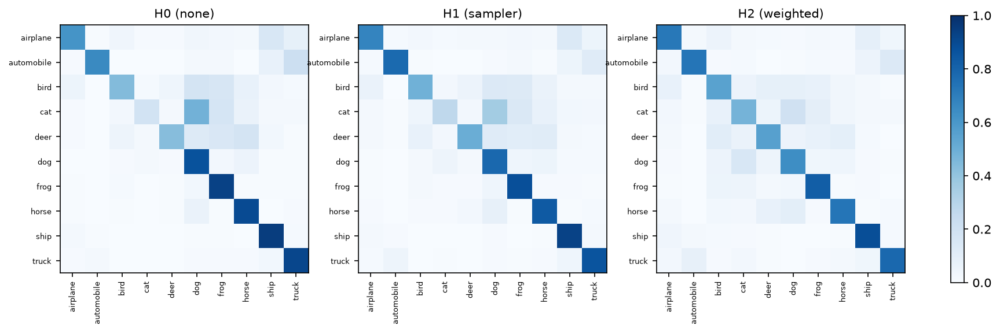

# 包③：CIFAR-10 迁移与类别不平衡实测报告

本报告由已完成的运行记录生成。CIFAR-10 测试集保持官方完整平衡划分（10000 张），仅用于最终评估。

## 数据与协议

CIFAR-10：10 类，32×32 彩色图，官方 50000 训练 / 10000 测试。训练集按固定种子 42 划分为 45000 训练 / 5000 内部验证，模型选择与训练监控只在内部验证上进行，测试集只评估一次。

模型为 ResNet18，从零训练（不使用 ImageNet 权重），输入 32×32，输出 10 类。训练增强为 RandomCrop(32, 4) + 水平翻转；SGD momentum=0.9、weight decay=5e-4、初始学习率 0.1、余弦退火，batch=128，30 轮，AMP 混合精度。设备为 NVIDIA L40S。

不平衡构造：选类别 0–4（airplane/automobile/bird/cat/deer）为少数类，各保留 10%；类别 5–9 保留 100%；抽样种子固定为 42。实际训练 24800 张，各类计数见 `runs/H0_seed42/config.json`。测试集不降采样，因此准确率下降完全来自训练分布。

| 编号 | 方法 |
|---|---|
| C1 | 完整数据，无处理（基准） |
| H0 | 不平衡子集，不做处理（对照组） |
| H1 | 加权随机采样（少数类重复采样） |
| H2 | 类别加权交叉熵，权重 ∝ 1/类频 |
| H3 | Focal Loss（可选，本次未运行） |

## 实测结果

| 实验 | 方法 | 测试准确率 | macro-F1 | 内部验证准确率 | 训练样本 |
|---|---|---:|---:|---:|---:|
| C1 | 无（完整数据） | 84.47% | 0.8452 | 85.10% | 45000 |
| H0 | 无（不平衡） | 68.87% | 0.6664 | 67.58% | 24800 |
| H1 | 重采样 | 70.03% | 0.6875 | 69.04% | 24800 |
| H2 | 类别加权 | 69.00% | 0.6878 | 68.40% | 24800 |

不平衡使总准确率下降 15.60 个百分点（C1 → H0）。两种方法都有小幅改善：H1 比 H0 高 1.16pp，H2 高 0.13pp；macro-F1 分别提高 2.11pp 和 2.14pp。

## 少数类与多数类

按前 5 类（少数类）与后 5 类（多数类）计算平均召回：

| 实验 | 少数类平均召回 | 多数类平均召回 |
|---|---:|---:|
| H0 | 46.54% | 91.20% |
| H1 | 54.22% | 85.84% |
| H2 | 60.82% | 77.18% |

- H1（重采样）：少数类 +7.68pp，多数类 −5.36pp。
- H2（类别加权）：少数类 +14.28pp，多数类 −14.02pp。

这说明总准确率会掩盖问题：H0 的 68.87% 里，多数类接近 91%，少数类只有 46.5%，尤其 cat 仅 18.5%。重采样与类别加权都在用多数类精度换少数类召回，H2 的交换最彻底、少数类提升最大，但因为牺牲过多多数类样本，总准确率几乎没有提升。若报告只看总准确率，会得出「两种方法都没用」的错误结论。





## C1 与参考区间

C1 测试准确率 84.47%，略低于计划中 85%–92% 的参考区间。原因是本次只训练 30 轮、未做学习率搜索、也未使用更长日程或更强增强；作为同一预算下的对照基准，它仍然满足 C1 的用途。若需进入参考区间，应优先增加训练轮数。

## 错误分析（验证集）

测试集无标签，因此错误分析在 5000 张验证集上进行，使用 `MF_seed42` 的预测。样例见 `error_examples.png`，逐条清单见 `error_cases.csv`：

- 2 个错例：`dog.7332` 图像旋转 90°、黑色短毛且蜷缩；`dog.669` 主体占比小、画面内另有动物。模型都以接近 1.0 的置信度判成猫。
- 2 个错例：`cat.7920` 猫狗同框且狗占主导；`cat.9897` 铁丝网密集遮挡主体。
- 2 个正确样例：`cat.100` 手持幼猫、`cat.1000` 笼中幼猫，背景杂乱但主体特征清晰。

结论：模型对清晰、居中的主体非常可靠；主要失效模式是**姿态/方向异常**、**多主体或背景动物干扰**、**强遮挡**。所有样例的真值均经核对无误，不存在标签噪声。

## 复现

```bash
python section3/cifar.py --experiment C1 --seed 42 --data data/cifar10 --amp --workers 4
python section3/run_all.py --data data/cifar10 --amp --workers 4 --queue C1:42 H0:42 H1:42 H2:42
python section3/summarize_results.py
python section3/error_analysis.py --predictions section2/results/MF_seed42/val_predictions.csv \
    --data data/datasets --output section3/artifacts
```

数据由 torchvision 自动下载到 `data/cifar10/`。实际参数见 `runs/*/config.json`。

## 解释边界

- 不平衡实验只有一个种子，改善量属于单次探索性结果，不宜声称统计显著。
- 少数/多数类的平均召回是按类别等权平均，未按样本数加权，与该类样本占比无关。
- 内部验证集与测试集同分布，但验证集仅用于选模；测试准确率只评估一次。
- 30 轮从零训练的 CIFAR-10 结果受训练预算限制，C1 低于参考区间上限不代表架构上限。
